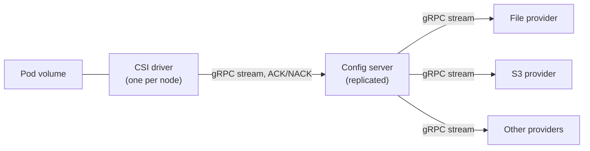

# Stevedore

Stevedore delivers configuration files to Kubernetes pods through a CSI driver.
A pod names the configuration it wants with URIs; the driver mounts the files
read-only and replaces them atomically when they change.

## How it works



- **CSI driver.** Runs on every node, subscribes to the config server for each
  volume, writes the files, and keeps the last known good version when anything
  upstream fails.
- **Config server.** Caches what providers emit and pushes it to the drivers.
  When a provider releases a new version to a share of the fleet first, the
  server decides which pods are in the share. The protocol
  acknowledges every update, in the style of Envoy xDS.
- **Providers.** Plugins behind one streaming gRPC interface. Each provider
  owns how configuration is published, validated and rolled out. This repository has a
  file provider, which serves a directory such as a mounted ConfigMap, and an
  S3 provider as a reference implementation.

Configuration content is opaque to the server and the driver. They deliver
bytes; they never parse them.

A pod asks for configuration with an inline volume:

```yaml
volumes:
  - name: config
    csi:
      driver: config.csi.stevedore.dev
      readOnly: true
      volumeAttributes:
        sources: |
          - uri: file:///payments/app.yaml
          - uri: file:///shared/flags/
```

The scheme names the provider. Each source lands at a location that follows
from its URI alone: the provider, then the path. Here that is
`file/payments/app.yaml` and the directory `file/shared/flags`, whose files
the provider names. A URI ending in `/` is a directory; any other is one file.
The pod does not choose file names or places: whoever knows the URI, such as a
client library, knows where its files are.

The full design, including caching, staged rollouts and application
acknowledgement, is in [docs/design.md](docs/design.md). The wire contracts are
in [api/stevedore/v1](api/stevedore/v1).

## Features

| Part | What it does |
|---|---|
| Protocols | Protobuf contracts for the driver and the server, the server and its providers, server replicas, and applications |
| CSI driver | Mounts a volume once every source is delivered, replaces files atomically on change, and resumes after a restart. Keeps a node cache, so a pod can start while the server is down, unless it sets `failurePolicy: Fail`. With `medium: Memory` a volume never touches the node's disk, which content marked `no_store` requires |
| Config server | Shares one provider watch between subscriptions and pushes each new revision. Caches what providers emit, with quotas, and keeps serving it while a provider is down. Runs as several replicas that copy each other's cache, so it survives a rollout without a persistent volume |
| File provider | Serves files and directories from a volume, such as a ConfigMap |
| S3 provider | Serves objects and prefixes from allow-listed buckets, on AWS or an S3-compatible store |
| Helm chart | Installs the driver and the server, and optionally the file and S3 providers |
| Security | Mutual TLS between all components, with a chart-issued private authority by default, your own certificates, or identities from a SPIFFE Workload API such as SPIRE. The server verifies which pod a volume belongs to from its service account token. There is no authorisation of which pods may read which URIs: any pod can read any URI the cluster's providers serve, so do not deliver secrets through it |
| Staged rollouts | A provider releases a new version to a growing share of pods and can hold it or take it back; the file and S3 providers have a time-based ramp |
| Metrics and events | Every component pushes metrics over OTLP to an OpenTelemetry collector (`telemetry.otlpEndpoint`). The driver records events on pods when their configuration is refused, rejected, late, stale or served from a cache |
| Application acknowledgement | A volume with `appAck: "true"` gets a manifest and an API on a Unix socket, as plain HTTP with JSON or as gRPC. The application reports whether it loaded each version; a rejected one is reverted at once and reported to the provider. With `appAckTimeout`, silence is reported too, and can hold a rollout |

What is built, against the design, is in the design's
[implementation status](docs/design.md#13-implementation-status).

## Install

The chart and images are published to quay.io and signed with cosign: every
release, and a snapshot of every commit to `main`. Releases and their notes are
on [GitHub](https://github.com/bpalermo/stevedore/releases).

| Artifact | Location |
|---|---|
| Chart | `oci://quay.io/stevedore/stevedore` |
| Images | `quay.io/stevedore/csi`, `server`, `provider-file`, `provider-s3` |

Install a release by its version:

```bash
helm install stevedore oci://quay.io/stevedore/stevedore --version 0.1.0 \
  --namespace stevedore-system --create-namespace
```

That installs the driver and the server with no provider, so no URI resolves
yet.

Each chart pins its images by digest, so a chart always runs the images built
from the same commit. In 0.x a release may change the protocol between the
components, so run all of them from the same release.

Between releases, every commit to `main` publishes a snapshot of the next one,
versioned `<next>-dev.<commit time>.g<commit>`. Snapshots are pre-releases, so
`--devel` takes the newest.

To serve a ConfigMap, enable the file provider and point it at one in the
release's namespace:

```bash
kubectl create namespace stevedore-system
kubectl create configmap app-config -n stevedore-system --from-literal=app.yaml='replicas: 1'

helm install stevedore oci://quay.io/stevedore/stevedore --version 0.1.0 \
  --namespace stevedore-system \
  --set providers.file.enabled=true \
  --set providers.file.source.configMap.name=app-config
```

A pod then mounts `file:///app.yaml` as shown above, and finds it at
`file/app.yaml` in the volume. A change to the ConfigMap
reaches the pod's files after kubelet refreshes the provider's mount, about a
minute.

To serve S3 buckets instead, enable the S3 provider and name the buckets it
may serve. With IAM roles for service accounts:

```bash
helm install stevedore oci://quay.io/stevedore/stevedore --version 0.1.0 \
  --namespace stevedore-system --create-namespace \
  --set providers.s3.enabled=true \
  --set providers.s3.region=eu-west-1 \
  --set 'providers.s3.buckets={acme-config}' \
  --set-string 'providers.s3.serviceAccount.annotations.eks\.amazonaws\.com/role-arn=arn:aws:iam::111122223333:role/stevedore-s3'
```

Pods then mount `s3://acme-config/payments/app.yaml`, found at
`s3/acme-config/payments/app.yaml`, or a prefix as a directory with
`s3://acme-config/shared/flags/`. Without `buckets`, the
provider serves every bucket its role can read to every pod.

To verify a signature:

```bash
cosign verify quay.io/stevedore/csi:v0.1.0 \
  --certificate-identity https://github.com/bpalermo/stevedore/.github/workflows/publish.yml@refs/tags/v0.1.0 \
  --certificate-oidc-issuer https://token.actions.githubusercontent.com
```

A snapshot is signed from `main` instead:

```bash
cosign verify quay.io/stevedore/csi:dev \
  --certificate-identity https://github.com/bpalermo/stevedore/.github/workflows/publish.yml@refs/heads/main \
  --certificate-oidc-issuer https://token.actions.githubusercontent.com
```

## Develop

Bazel is the only build; [Bazelisk](https://github.com/bazelbuild/bazelisk)
picks the version from `.bazelversion`, and Bazel downloads the Go toolchain.

```bash
bazel test //...        # build and unit tests
bazel run //:gazelle    # after adding, removing or renaming a Go file
e2e/run.sh              # end-to-end suite in a kind cluster
```

The end-to-end suite needs `kind`, `kubectl`, `helm` and a container runtime.
It builds the images and the chart from the checkout and installs them; with
`E2E_CHART` and `E2E_CHART_VERSION` it tests a published chart instead.

| Directory | Contents |
|---|---|
| `api/stevedore/v1` | Protocol definitions |
| `csi` | CSI node driver |
| `server` | Config server |
| `providers/file` | File provider |
| `providers/s3` | S3 reference provider |
| `common` | Code shared between the binaries |
| `charts/stevedore` | Helm chart |
| `e2e` | End-to-end tests |
| `bazel`, `scripts` | Build rules and release tooling |

[AGENTS.md](AGENTS.md) has the conventions for working in the repository.

## License

[Apache 2.0](LICENSE)
