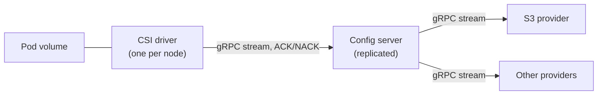

# Chandler

Chandler delivers configuration files to Kubernetes pods through a CSI driver.
A pod names the configuration it wants with URIs; the driver mounts the files
read-only and replaces them atomically when they change.

> **Status: early development.** The CSI driver mounts a volume, but nothing
> delivers configuration into it yet. The config server and the S3 provider are
> placeholders. See [What works today](#what-works-today).

## How it is meant to work



- **CSI driver.** Runs on every node, subscribes to the config server for each
  volume, writes the files, and keeps the last known good version when anything
  upstream fails.
- **Config server.** Caches what providers emit, rolls new versions out to a
  growing percentage of pods, and pushes them to the drivers. The protocol
  acknowledges every update, in the style of Envoy xDS.
- **Providers.** Plugins behind one streaming gRPC interface. Each provider
  owns how configuration is published and validated; the S3 provider in this
  repository is a reference implementation.

Configuration content is opaque to the server and the driver. They deliver
bytes; they never parse them.

A pod asks for configuration with an inline volume:

```yaml
volumes:
  - name: config
    csi:
      driver: csi.chandler.dev
      readOnly: true
      volumeAttributes:
        sources: |
          - uri: s3://acme-config/payments/app.yaml
            path: app.yaml
          - uri: s3://acme-config/shared/flags/
            path: flags
```

The full design, including caching, staged rollouts and application
acknowledgement, is in [docs/design.md](docs/design.md). The wire contracts are
in [api/chandler/v1](api/chandler/v1).

## What works today

| Part | State |
|---|---|
| Protocol definitions | Written, for all three protocols |
| CSI driver | Registers with the kubelet and mounts an empty read-only volume; `sources` is not read yet |
| Config server | Placeholder binary |
| S3 provider | Placeholder binary |
| Helm chart | Installs the CSI driver only |
| Staged rollouts, caching, application acknowledgement | Designed, not built |

## Install

The chart and images are published to quay.io on every commit to `main`, and
signed with cosign.

| Artifact | Location |
|---|---|
| Chart | `oci://quay.io/shipchandler/chandler` |
| Images | `quay.io/shipchandler/csi`, `server`, `provider-s3` |

Every chart is currently a snapshot, versioned
`0.0.0-dev.<commit time>.g<commit>`. Snapshots are pre-releases, so pass
`--devel` to take the newest one, or `--version` to pin one:

```bash
helm install chandler oci://quay.io/shipchandler/chandler \
  --namespace chandler-system --create-namespace --devel
```

Each chart pins the CSI image by digest, so a chart always runs the image built
from the same commit.

To verify a signature:

```bash
cosign verify quay.io/shipchandler/csi:dev \
  --certificate-identity-regexp '^https://github\.com/bpalermo/chandler/\.github/workflows/publish\.yml@refs/heads/main$' \
  --certificate-oidc-issuer https://token.actions.githubusercontent.com
```

## Develop

Bazel is the only build; [Bazelisk](https://github.com/bazelbuild/bazelisk)
picks the version from `.bazelversion`, and Bazel downloads the Go toolchain.

```bash
bazel test //...        # build and unit tests
bazel run //:gazelle    # after adding, removing or renaming a Go file
e2e/run.sh              # end-to-end suite in a kind cluster
```

The end-to-end suite needs `kind`, `kubectl`, `helm` and a container runtime.
It builds the images and the chart from the checkout and installs them.

| Directory | Contents |
|---|---|
| `api/chandler/v1` | Protocol definitions |
| `csi` | CSI node driver |
| `server` | Config server |
| `providers/s3` | S3 reference provider |
| `common` | Code shared between the binaries |
| `charts/chandler` | Helm chart |
| `e2e` | End-to-end tests |
| `bazel`, `scripts` | Build rules and release tooling |

[AGENTS.md](AGENTS.md) has the conventions for working in the repository.

## License

[Apache 2.0](LICENSE)
