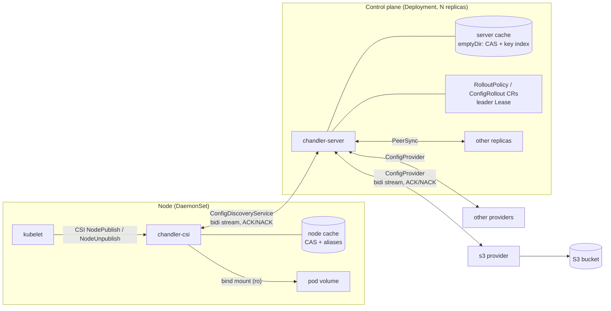
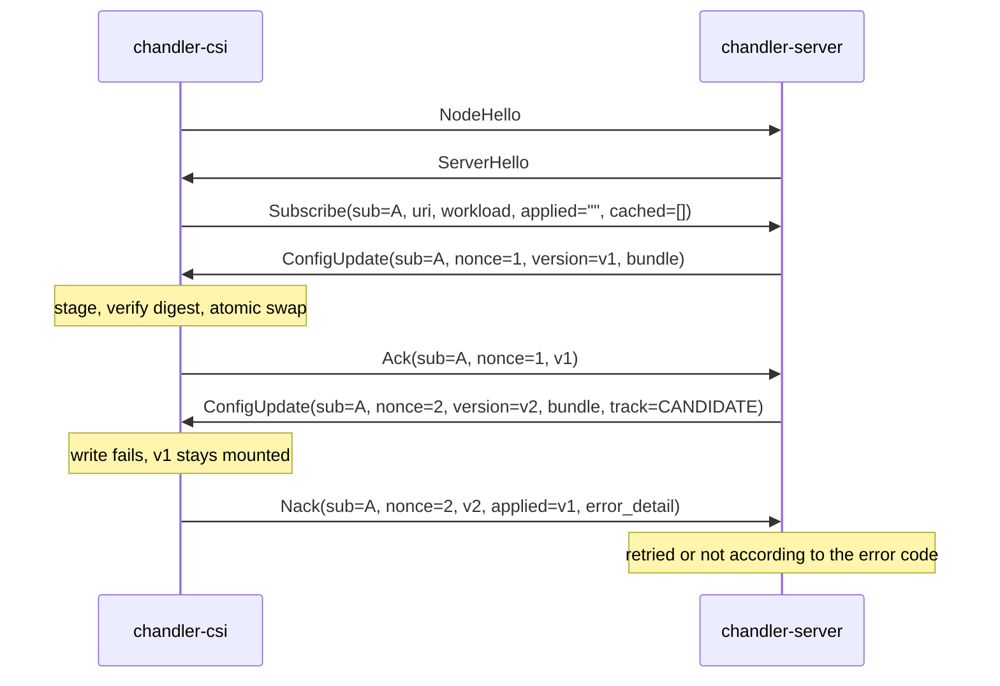
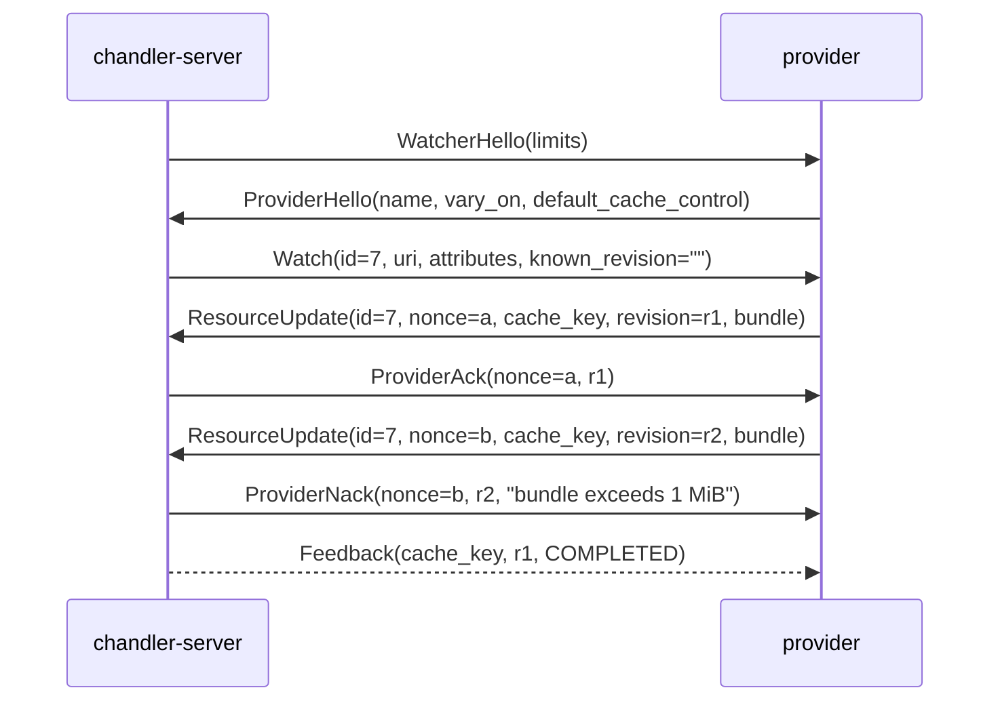
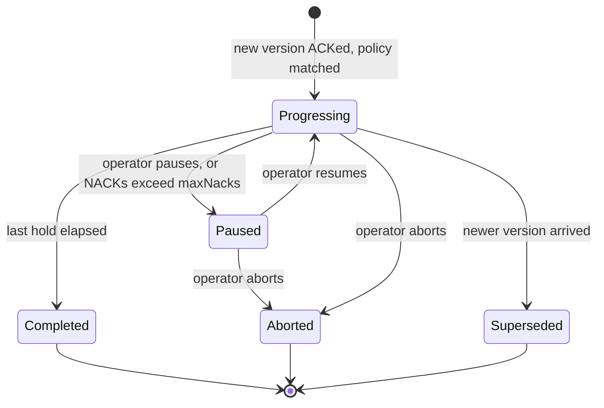

# Chandler: configuration delivery over CSI

Status: draft, 2026-10-12

Chandler mounts configuration files into pods through a Kubernetes CSI driver.
A pod names what it wants with URIs (`<provider-name>://...`); the driver
subscribes to a config server, which sources the content from pluggable
providers, caches it, rolls new versions out progressively, and pushes them to
the node. The node replaces the files atomically and keeps the last known good
version whenever anything upstream fails or a new version cannot be written.

The wire contracts are in [`api/chandler/v1`](../api/chandler/v1):
`discovery.proto` (driver ↔ server), `provider.proto` (server ↔ provider),
`peer.proto` (server ↔ server), `common.proto` (shared types). This document explains the design around them.

## 1. Goals and non-goals

Goals

- Config files appear in a pod volume before its containers start, and are
  updated in place without restarting the pod.
- Driver ↔ server protocol with per-update ACK/NACK, in the style of Envoy xDS.
- Providers are plugins behind one bidirectional-streaming gRPC interface.
- Staged rollout: a new version reaches pods gradually, by percentage, rather
  than all at once, and an operator can pause or abort the ramp.
- Provider failure, server failure and node restarts do not take config away
  from running pods and, where a cache exists, do not block new pods.
- Updates are atomic per volume; the last known good config is always kept.
- An application can optionally report whether it loaded or rejected a
  config, over a plain HTTP API on a Unix socket in the volume. A rejection
  reverts that pod and can pause a rollout.
- Caching is keyed by provider-issued cache keys and is bounded by design.
- Configuration content is opaque to the server and the driver. Neither parses
  or interprets it; a provider is responsible for the validity of what it
  emits.

Non-goals

- Validating configuration. The server and driver check only what they need
  to deliver a bundle safely: its digest, its size and file count, and that
  its paths stay inside the volume. Whether the content is a good config is
  the provider's concern before it emits and the application's after.
- How configuration gets into a provider. Authoring, uploading and
  validating config happen on the provider's side of the `ConfigProvider`
  interface. Chandler defines how config is delivered, not how it is
  published; each provider must offer its users a safe way to do that.
- Large artifacts. A bundle is capped (default 1 MiB, hard cap 3 MiB) and sent
  in one gRPC message; there is no chunking.
- Secrets management. Content can be marked `no_store`, but Chandler is not a
  replacement for a secrets driver.
- Templating or merging config on the node. Providers produce final bytes.
- Telling the application to reload. Apps watch the volume, exactly as they do
  for ConfigMap volumes.

## 2. Architecture



| Component | Runs as | Responsibility |
|---|---|---|
| `chandler-csi` | DaemonSet, CSI node plugin (ephemeral inline volumes) | Mount volumes, hold one stream to the server, atomically write updates, ACK/NACK, node cache |
| `chandler-server` | Deployment, several replicas, cache on `emptyDir` | Authorise subscriptions, coalesce them into provider watches, cache and replicate the cache to peers, decide which version each pod gets (rollouts), push |
| Providers | In-process (built-in) or separate gRPC services | Resolve a URI to a bundle, issue its cache key and revision, push changes |

Each cluster runs its own set of server replicas; servers are not shared
across clusters, so rollout state can live in that cluster's API objects.

There are three cache tiers, each able to serve when the one above it is gone:
origin → server cache → node cache → the volume itself (which is never emptied).

### Pod API

```yaml
volumes:
  - name: config
    csi:
      driver: csi.chandler.dev        # placeholder domain
      readOnly: true
      volumeAttributes:
        sources: |
          - uri: s3://acme-config/payments/app.yaml
            path: app.yaml
          - uri: s3://acme-config/shared/flags/     # trailing slash: directory bundle
            path: flags
        failurePolicy: UseCached      # or Fail (default)
```

The `CSIDriver` object sets `attachRequired: false`,
`volumeLifecycleModes: [Ephemeral]`, `podInfoOnMount: true` and a
`tokenRequests` entry with the server's audience, so every mount carries the
pod's namespace, name, UID, service account and a pod-bound token.

## 3. URIs and cache keys

A subscription names a resource as `<provider-name>://<authority>/<path>?<query>`.
The scheme selects the provider; everything after it is the provider's to
interpret. The server canonicalises the URI before doing anything else:
lowercase scheme, remove dot segments, sort query parameters, drop the
fragment, reject userinfo.

The mapping to HTTP caching is direct:

| HTTP | Chandler |
|---|---|
| Request URL | Canonical URI |
| `Vary` | `ProviderHello.vary_on`: subscriber attributes the content may depend on |
| Cache key | `cache_key` issued by the provider in every `ResourceUpdate` |
| `ETag` | `revision` (provider's opaque validator) |
| `If-None-Match` / 304 | `Watch.known_revision` / `NotModified`; `Subscribe.cached_versions` / `UseCached` |
| `Cache-Control: max-age, stale-if-error, no-store` | `CacheControl` |

Two identifiers are kept apart on purpose. The **revision** is whatever the
provider uses to detect change (an ETag, an object version). The **version** is
`sha256` over the bundle's canonical encoding, computed by the server. Drivers
and rollouts only ever see versions, so a provider re-emitting identical bytes
under a new revision causes no rollout and no churn.

### Why the provider issues the key

Only the provider knows which parts of a URI are significant. `cache_key` is
its normalised identity for the resource, and many URIs may collapse onto one
key. The server stores a small alias `(canonical URI, vary values) → cache_key`
so that it can answer from cache without the provider.

### Preventing cache explosion

The cache is bounded by construction rather than by eviction alone:

1. **Keys come from the provider, never from the client.** Providers must
   reject query parameters they do not understand (`INVALID_ARGUMENT`) instead
   of ignoring them, so decorating a URI cannot mint new aliases or keys.
2. **Vary is declared once and allow-listed.** A provider states `vary_on` in
   its handshake; the server refuses any attribute not on its allow-list of
   low-cardinality attributes (cluster, region, zone, namespace, service
   account). Pod name, UID and IP can never enter a key. `Watch.attributes`
   carries only the declared attributes, so the provider cannot vary on
   anything else even by accident.
3. **Per-pod differences are not cache entries.** Rollout placement is the
   only per-pod decision in the system, and it selects among the few versions
   already held for one key. It never creates a key.
4. **Content is stored once.** Bytes live in a content-addressed store; keys
   point to digests. Ten keys with identical content cost one blob.
5. **Versions per key are capped at three**: stable, candidate, previous.
   Rejected versions are remembered as digests only.
6. **Quotas fail loudly.** Per provider: max keys, max bytes, max keys per
   canonical URI (the variant cap, default 16). Per namespace: max distinct
   URIs. Per bundle: max bytes and files. Exceeding one NACKs the provider or
   fails the subscription with `RESOURCE_EXHAUSTED`. Nothing in use is ever
   evicted to make room.
7. **Eviction is by reference.** A key with live subscriptions is pinned. An
   unreferenced key is kept for a grace period (default 24h, so pods can
   restart through a provider outage) and is then LRU-evictable.
8. **Negative results are cached briefly** (`NOT_FOUND`, `PERMISSION_DENIED`;
   default 30s, bounded count) so a crash-looping pod cannot hammer a provider.

Keys per provider and variants per URI are exported as metrics, with the
quotas as alert thresholds.

## 4. Driver ↔ server protocol

One stream per node carries every subscription on that node. A subscription is
one source of one pod volume: `(subscription_id, uri, workload)`.



Rules

- **Every `Subscribe` gets exactly one initial answer**, a `ConfigUpdate` or a
  `SubscriptionError`. This is what unblocks `NodePublishVolume`. After an
  error the subscription stays open and an update follows when one exists.
- **ACK means written.** The bundle was verified against its digest and
  atomically swapped into the volume; the version is now that subscription's
  last known good. The driver cannot tell a good config from a bad one, so an
  ACK says nothing about the content.
- **NACK means not written**, with the previous version untouched. It reports
  a delivery failure, never an opinion about the content; `error_detail` says
  which (see the table in section 5).
- **Nonces** are unique per stream. The server tracks, per subscription, the
  last sent nonce and version, the last ACKed version and the last NACK. An
  ACK or NACK whose nonce is not the latest sent for that subscription is
  ignored: the server may supersede an unanswered update, and only the newest
  counts.
- **Whether a NACKed version is resent depends on the code.** `DATA_LOSS`
  makes the server resend the full bundle at once. A node-side failure
  (`RESOURCE_EXHAUSTED`, `INTERNAL`) is retried with backoff. A bundle that
  can never be written to that volume (`FAILED_PRECONDITION`,
  `INVALID_ARGUMENT`) is not resent to that subscription.
- **No answer within 60s** and the update is sent again once.
- **Reconnect** is a full resync: the driver resubscribes everything with
  `applied_version` and `cached_versions`. The server answers each with its
  target version, as `UseCached` when the node already has the bytes, so a
  resync moves metadata only. Drivers reconnect with jittered backoff; the
  server sets a max connection age to rebalance streams across replicas.
- **`AppReport` is a separate, optional stage after the ACK.** For volumes
  that opt in, the driver relays the application's own verdict (loaded or
  rejected) on a version it wrote; see "Application acknowledgement" in
  section 5. It needs no answer.
- **Config is never withdrawn from a running pod.** The protocol has no delete
  toward the driver; see deletion handling in section 7.

Unlike xDS, requests are a `oneof` and a response carries a single
subscription's update. Envoy's overloaded `DiscoveryRequest` makes an ACK and a
subscription change look alike, and a NACK there rejects a whole response; here
a failed write for one pod's source must not affect any other pod on the node.

## 5. Node: atomic replacement and last known good

State lives under a hostPath so mounts and cache survive driver restarts:

```
/var/lib/chandler/
  blobs/sha256/<aa>/<digest>          node cache: content-addressed, node-wide
  index.db                            alias → cache_key → versions → manifest
  volumes/<volume-id>/                CSI volume ID; kubelet derives it from pod UID and volume name
    meta.json                         sources, applied versions (for resubscribe)
    data/                             bind-mounted read-only into the pod
      ..2026_10_12_07_51_00.123/      generation directory (current)
      ..2026_10_12_07_40_11.987/      generation directory (previous)
      ..data -> ..2026_10_12_07_51_00.123
      app.yaml -> ..data/app.yaml
      flags    -> ..data/flags
      ..chandler.json -> ..data/..chandler.json   only with appAck
      ..chandler.sock                             only with appAck
```

Applying an update, per subscription:

1. **Stage.** Write the bundle into the node cache (or locate it, for
   `UseCached`). Verify the version digest.
2. **Check deliverability.** Paths stay inside the volume, size and file
   count are within limits, and no path collides with the volume's other
   sources. File contents are never opened or parsed. Failure → NACK, nothing
   on disk has changed.
3. **Build a generation.** A new directory holding the *whole volume*: this
   source's new bundle plus the currently applied bundle of every other
   source. Files are hardlinked from the node cache (the mount is read-only).
4. **Swap.** Create a `..data_tmp` symlink to the new generation and
   `rename(2)` it over `..data`. This is the same mechanism as Kubernetes'
   atomic writer for ConfigMap volumes: readers see the old tree or the new
   tree, never a mix, and existing `..data` watchers work unchanged.
5. **ACK**, update `meta.json`, and garbage-collect all but the current and
   previous generation.

The driver NACKs only for these reasons:

| Code | Cause | Server reaction |
|---|---|---|
| `DATA_LOSS` | Digest mismatch, or a `UseCached` version missing from the node cache | Resend the full bundle |
| `RESOURCE_EXHAUSTED` | Node disk or the volume's size limit is full | Retry with backoff |
| `INTERNAL` | I/O error while staging or swapping | Retry with backoff |
| `FAILED_PRECONDITION` | A path collides with another source of the same volume | Do not resend; counts toward `maxNacks` |
| `INVALID_ARGUMENT` | Unsafe path or bundle over the limits (the server should have refused it) | Do not resend; counts toward `maxNacks` |

Last known good therefore means the last version successfully written, or,
for a volume with application acknowledgement, the last version the
application reported as loaded. It holds at three levels: a failed update leaves `..data` where
it was; the previous generation stays on disk; and the node cache keeps the
blobs of the current and previous version of every live volume, so a server
rollback is a `UseCached` update and a local swap, with no bytes on the wire.

### Application acknowledgement

An ACK from the driver means "written". An application can optionally add the
stage only it can judge: "loaded" or "rejected". This keeps the core opaque:
the application decides whether a config is good, and the driver and server
only carry its verdict.

A volume opts in with the attribute `appAck: "true"`. The driver then adds two
entries at the volume root:

```
..chandler.json -> ..data/..chandler.json    manifest of the current generation
..chandler.sock                              Unix socket served by the driver
```

**Manifest.** Written into every generation directory, so it is swapped
atomically with the content it describes. A volume can combine sources from
several providers, so the manifest lists each one with its own version. A
source's `name` comes from the volume attributes and defaults to its `path`.

```json
{
  "generation": "g-5d41402abc4b2a76",
  "sources": [
    {"name": "app",   "uri": "s3://acme-config/payments/app.yaml", "path": "app.yaml", "version": "sha256:9f86d0..."},
    {"name": "flags", "uri": "flagstore://payments/eu",            "path": "flags",    "version": "sha256:2c26b4..."}
  ]
}
```

`generation` identifies this exact combination of source versions.

**Socket.** The driver serves plain HTTP/1.1 with JSON bodies on the socket;
there is no gRPC and no client library. Connecting works although the volume
is mounted read-only. Each volume has its own socket, so the driver knows
which pod and volume is speaking without any authentication; any container
that mounts the volume may report, which also lets a sidecar report on behalf
of an application that cannot be changed.

| Request | Purpose |
|---|---|
| `GET /v1/config` | The manifest, plus the state the driver has recorded for each source (`pending`, `loaded`, `rejected`) |
| `POST /v1/reports` | Report the outcome of loading a generation |

A report names the generation the application read and gives a state for all
of it, or for individual sources:

```json
{"generation": "g-5d41402abc4b2a76", "state": "loaded"}
```

```json
{
  "generation": "g-5d41402abc4b2a76",
  "sources": [
    {"name": "app",   "state": "loaded"},
    {"name": "flags", "state": "rejected", "message": "unknown flag 'checkout.v3'"}
  ]
}
```

```
curl --unix-socket /etc/payments/..chandler.sock \
  -d '{"generation":"g-5d41402abc4b2a76","state":"loaded"}' http://chandler/v1/reports
```

- With `sources`, only the listed sources are affected; the others stay
  `pending`. An application whose components load different sources at
  different times sends several reports and they accumulate.
- Without `sources`, the top-level `state` applies to every source.
- The driver resolves the generation to source versions and records each
  verdict against `(source, version)`, so a report stays meaningful for the
  sources that did not change when a newer generation has arrived meanwhile.
- Responses: `204` accepted; `400` malformed; `404` unknown source name;
  `409` when the generation is neither the current nor the previous one, with
  the current manifest in the body so the application can reload and retry.

**What the driver does with a verdict.**

- `loaded`: the version becomes the source's last known good, which now means
  the last version the application accepted rather than the last one written.
- `rejected`: the driver immediately builds a new generation with that source
  back on its last loaded version and swaps it in, without waiting for the
  server. The application may still hold the old config in memory, but if it
  restarted it would otherwise read the rejected files from disk. A rejection
  of the whole generation reverts every source whose version differs from its
  last loaded one. If a source has never had a loaded version (first mount)
  there is nothing to revert to and the files stay.
- Either way the driver forwards an `AppReport` to the server for each source
  affected. The server does not send a rejected version to that subscription
  again, and rollouts can react to the reports (section 8).

Verdicts are kept in `meta.json`, and the driver re-creates the sockets when
it restarts. The driver binds through a directory file descriptor, so the
socket's long host path does not hit the 108-byte limit; inside the container
the mount path plus `/..chandler.sock` must fit in it. As with updates, a
`subPath` mount sees neither the manifest nor the socket.

### Mounting

`NodePublishVolume` creates the volume directory, subscribes every source and
waits for all initial answers (deadline 90s, inside kubelet's own timeout)
before mounting, so a container never starts with a partial volume. If the
server is unreachable or answers `UNAVAILABLE`:

- `failurePolicy: Fail` returns an error; kubelet retries and the pod waits in
  `ContainerCreating` with an event explaining why.
- `failurePolicy: UseCached` materialises the newest cached version for each
  source if the node cache has one, mounts, and converges once the server
  returns. With no cached version it fails as above.

On driver restart the mounts are still in place; the driver rebuilds its
subscriptions from the `meta.json` files and resyncs. `no_store` bundles are
written to a per-volume tmpfs and never enter the node cache, so they do not
survive a node reboot without the server. As with ConfigMaps, `subPath` mounts
do not see updates.

## 6. Server ↔ provider protocol

Each server replica dials each registered provider and holds one stream. Many pod
subscriptions coalesce into one watch per `(canonical URI, projected vary
attributes)`.



- `ProviderAck` means the revision was accepted for delivery and cached. The
  server checks only the envelope: bundle size and file count, path safety,
  and the cache-key and quota rules. It never inspects the content.
  `ProviderNack` means the envelope was refused and the server keeps serving
  its last version.
- **Validity is the provider's job.** Anything a provider emits is written to
  pods as is, so a provider must only emit revisions it knows to be valid.
  The expected way to guarantee that is to validate on upload: the provider
  owns the path by which config enters its store (an upload API, a review
  gate, a signing step) and refuses invalid config there, so that nothing
  invalid is ever stored, let alone emitted. That path is entirely the
  provider's; it is not part of Chandler and does not appear in these
  protocols.
- `Feedback` is the late, informational outcome of the rollout (completed,
  aborted, superseded), since an ACK cannot know that yet.
- On reconnect the server re-watches everything with `known_revision`; the
  provider answers `NotModified` for what has not changed.

### S3 provider (reference implementation)

The S3 provider is a reference implementation of `ConfigProvider`, not the
intended production provider and not the only one. It exists to show the
protocol end to end with the simplest possible origin, and to be the thing
other providers are modelled on.

It is read-only and has no upload path of its own: it emits whatever is in the
bucket. It therefore relies on whoever writes to the bucket to have validated
the content, which is a weaker guarantee than the contract above asks of a
real provider. A production provider would put its own upload API in front of
its store and validate there.

| Aspect | Behaviour |
|---|---|
| URI | `s3://<bucket>/<key>` for one object; `s3://<bucket>/<prefix>/` for a directory bundle. Any query parameter is rejected. |
| `cache_key` | `<bucket>/<key-or-prefix>` |
| `vary_on` | empty |
| `revision` | Object: version id if the bucket is versioned, else ETag. Prefix: hash of the sorted `(key, ETag)` list. |
| Change detection | Jittered poll (default 30s) using `HeadObject` / `ListObjectsV2` and conditional `GetObject`; optional S3 event notifications through SQS to trigger an immediate check. |
| Consistent prefix read | List, then `GetObject` each key with `If-Match` on the listed ETag; any mismatch restarts the read, so a bundle is never a mix of two uploads. |
| `CacheControl` | From the object's `Cache-Control` metadata, else provider defaults. |
| Deletion | `Deleted` once the object or the whole prefix is gone. |

The provider name is the scheme, so two buckets with different credentials are
simply two registered providers (`s3-prod://`, `s3-shared://`) of the same
implementation.

## 7. Server cache, peer sync and provider failure

Each replica keeps a cache on an `emptyDir`: a content-addressed blob store, a
key index (`cache_key → current version, held versions, revision,
CacheControl, last refresh`) and the alias table. `no_store` bundles are held
in memory only.

There is no persistent volume. A volume per replica is zone-bound, so it would
keep a replica from rescheduling in exactly the failures the cache exists for,
and it would make the config system depend on a storage driver to start. The
cache is small by construction, so replicas keep each other's copies instead.

### Peer sync

Replicas find each other through a headless Service and speak `PeerSync`
([`peer.proto`](../api/chandler/v1/peer.proto)).

- **Warm-up.** A starting replica lists the keys of a ready peer and fetches
  every bundle it lacks before it reports ready. An `emptyDir` survives
  container restarts, so after a crash this is usually a no-op. If no peer is
  ready (first replica, or the whole fleet was lost) it becomes ready at once
  and fills from the providers on demand.
- **Anti-entropy.** Every 30s each replica lists one peer's keys and pulls
  what it lacks. All replicas converge on the union of keys, including keys
  only one replica's drivers subscribe to, so drivers can move to any replica.
- **On demand.** A replica that needs a version named in a `ConfigRollout`
  and cannot get it from the provider asks its peers for it.

Bundles are verified against their version digest on receipt. When entries
differ, a replica with a live provider watch for the key trusts its own
stream; otherwise it adopts the entry most recently confirmed with the
provider. Eviction uses the same grace period everywhere on a merged
last-referenced time, so one replica does not resurrect what another evicted.

A PodDisruptionBudget, zone spreading and the warm-up readiness gate ensure a
rolling restart never proceeds until the new replica holds the cache, even
while a provider is down.

### Provider failure

| Key state | Condition | New subscriptions | Existing subscribers |
|---|---|---|---|
| Live | Provider watch healthy | Served, `stale=false` | Receive pushes |
| Stale | Provider down, within `max_age + stale_if_error` | Served, `stale=true` | Keep applied version |
| Expired | Provider down, past `stale_if_error` | `UNAVAILABLE` | Keep applied version |

`stale_if_error` defaults to unlimited: for configuration, an old version is
almost always better than none. When the provider returns, the server
re-watches with `known_revision` and resumes normal operation. Rollouts whose
candidate is already cached continue during an outage.

**What is not covered.** If every replica loses its cache at the same time
while a provider is down, the server has nothing to serve for that provider's
keys. Running pods are unaffected. New pods on nodes without a node cache wait
for the provider; new pods on nodes with one start only if they set
`failurePolicy: UseCached`.

**Deletion at the origin** is treated as dangerous. With `onDelete: Retain`
(default) the key is marked orphaned, keeps being served from cache and raises
an alert. With `onDelete: Block` new subscriptions get `NOT_FOUND`. In both
cases running pods keep their files.

## 8. Staged rollouts

The purpose of a rollout is that a new version does not reach every pod at the
same moment. A new version of a key is released to a growing percentage of its
subscribers over time. Because the content is opaque, nothing in Chandler can
judge whether a version is good: the ramp buys time for people and their
monitoring to notice a bad one and stop it before it is everywhere.

A `RolloutPolicy` matches URIs and defines the ramp. Without a matching policy
a new version goes to everyone at once. A key's first version is always served
immediately.

```yaml
apiVersion: chandler.dev/v1alpha1
kind: RolloutPolicy
metadata:
  name: payments
spec:
  match:
    uris: ["s3://acme-config/payments/**"]   # most specific match wins
  steps:                  # after the last hold the version goes to 100%
    - {percent: 1,  hold: 5m}
    - {percent: 10, hold: 10m}
    - {percent: 50, hold: 10m}
  maxNacks: 0             # undeliverable-bundle NACKs tolerated before pausing
  appAck:                 # optional; applies to pods whose volume sets appAck
    maxRejects: 0         # application rejections tolerated before pausing
    loadTimeout: 2m       # written but not reported within this counts as a timeout
    maxTimeouts: 5        # timeouts tolerated before pausing
  onDelete: Retain
```

**Who gets the new version.** A pod receives the candidate when

```
hash(version, pod UID) mod 10000 < percent × 100
```

and the stable version otherwise. This needs no per-pod state and no
coordination: any replica gives the same answer for the same pod. The set only
grows as the percentage rises, so a pod never flips back and forth. Salting
with the version means a different set of pods goes first each time. Pods that
start mid-rollout are placed by the same rule.

**Rollout state.** A `ConfigRollout` object per `(cache_key, version)` records
the stable version, the candidate version, the start time and the phase.
Replicas watch these objects; the current percentage is a pure function of the
policy steps and the time since start, so every replica computes the same ramp
without exchanging anything else.

**Leader.** Replicas have independent provider streams and versions are
content digests with no inherent order, so two replicas can disagree about
which version is newest (one poll may skip a version another one saw). One
replica therefore holds a `Lease` and is the only one that turns "the provider
emitted a version" into rollout state. The order of versions is the order the
leader observed them. Only replicas that have finished warm-up campaign.

| Leader only | Any replica |
|---|---|
| Create a `ConfigRollout`, supersede an older one | Serve and place pods by the hash rule |
| Mark a rollout completed and move the stable version | Advance the ramp (it is computed, not stored) |
| Sum NACK, rejection and timeout counts when a threshold is above zero | Pause a rollout on an undeliverable-bundle NACK or an application rejection |

A follower that has received a version the leader has not recorded yet holds
it and serves it to nobody. A follower that lacks the candidate's bytes serves
stable until it gets them from the provider or a peer. Pausing is open to
every replica because a safety stop must not wait for a leader.

If the leader is lost, new versions are not picked up until another replica
takes the lease (about 15s); running ramps continue and pods keep being
served. All writes use optimistic concurrency. A new leader reconciles on
takeover: if a key has more than one unfinished rollout, it keeps the one
matching its own view of the provider and supersedes the rest.



- **Paused**: the percentage is frozen. Pods that already took the candidate
  keep it. An operator pauses when the new config misbehaves. The system
  pauses on its own only when the bundle itself cannot be written
  (`FAILED_PRECONDITION` or `INVALID_ARGUMENT` NACKs above `maxNacks`), or
  when the policy has an `appAck` block and applications reject the version
  or fail to report it loaded in time. Node problems such as a full disk do
  not pause a rollout. Time spent paused does not count toward the ramp.

  Application reports are the only signal about the content itself. A
  rejecting pod has already been reverted by its driver; pausing keeps the
  version from reaching more pods. A timeout only pauses: a pod is never
  reverted for being slow to report.
- **Completed**: the leader makes the candidate the stable version; the object
  is removed after a retention period.
- **Aborted**: pods on the candidate are sent the stable version again (a
  `UseCached` update, since the node still has it). The object is kept so the
  same version is not rolled out again if the provider re-emits it, and the
  provider gets `Feedback(ABORTED)`.
- **Superseded**: a newer version restarts the ramp from the first step, with
  the stable version unchanged. Pods on the old candidate move to the new one
  or back to stable according to the new hash.

The operator pauses, resumes or aborts by editing the `ConfigRollout`.

## 9. Security

- Driver ↔ server, server ↔ provider and server ↔ server use mTLS. `PeerSync`
  accepts only the server identity.
- The server verifies `Workload.service_account_token` (audience-bound,
  pod-bound) and takes namespace, service account and pod identity from the
  token, not from the driver's claims.
- **Authorisation is mandatory.** The server holds the provider credentials, so
  without a check any pod could mount any URI the server can read. A policy
  maps namespaces and service accounts to URI patterns; the default is deny.
- The acknowledgement socket is reachable only from containers that mount the
  volume, and a report can only affect that volume and the rollout counters
  of the configs it holds. Request bodies are size-limited.
- Bundle paths are checked on both server and node; the volume is always
  mounted read-only.

## 10. Failure modes

| Failure | Running pods | New pods |
|---|---|---|
| Provider down | Keep current files | Served from server cache (`stale=true`) until `stale_if_error` |
| Provider emits an oversized bundle or unsafe paths | Unaffected; server NACKs provider | Get the last version |
| Provider emits a bad config | Written to the percentage reached; operator pauses or aborts | Placed by the same hash rule |
| Server down, all replicas | Keep current files | `UseCached`: from node cache if present; `Fail`: wait |
| One replica restarts during provider outage | Keep current files | Unaffected; the replica warms from a peer before it is ready |
| All replicas lose their cache during provider outage | Keep current files | Node has a cache and `UseCached`: start; otherwise wait for the provider |
| Rollout leader lost | Keep current files; running ramps continue | Served as usual; new versions wait for re-election (about 15s) |
| Driver restarts | Mounts stay; resync on start | Mount waits for driver, kubelet retries |
| Node reboots | n/a | Node cache persists; behaves as server-down or normal |
| Application rejects a config (volume with `appAck`) | That pod is reverted to its last loaded version at once; rollout pauses per policy | Placed by the same hash rule |
| Update cannot be written on a node | NACK, previous generation stays; retried per error code | n/a |
| Origin object deleted | Keep current files | `Retain`: cached version; `Block`: `NOT_FOUND` |
| Cache quota reached | Unaffected | New keys refused with `RESOURCE_EXHAUSTED`; existing keys unaffected |

## 11. Observability

- Server: subscriptions and watches by provider; cache keys, bytes and
  variants per URI against quota; stale and orphaned keys; ACK/NACK counts by
  rollout; provider stream state; peer sync age and keys pulled; which replica
  holds the lease.
- Driver: application reports by state, apply latency, NACKs by reason, node cache size, mounts served from
  cache, time blocked in `NodePublishVolume`.
- Kubernetes events on the pod for NACKs and stale or cached mounts;
  `ConfigRollout.status` carries the phase, current percentage and NACK count.

## 12. Open questions

1. **Health-based pausing.** For pods without application acknowledgement, a
   bad config is stopped only by an operator pausing the ramp. Pausing
   automatically on pod restarts or lost readiness, which needs no change to
   the application, is not designed.
2. **Total cache loss.** When the server has nothing for a key, it could
   answer "use your newest cached version, marked stale" so that pods on
   nodes with a node cache start regardless of `failurePolicy`. Not adopted
   yet.
