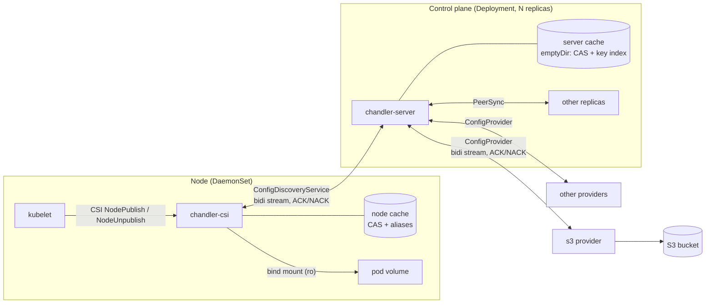
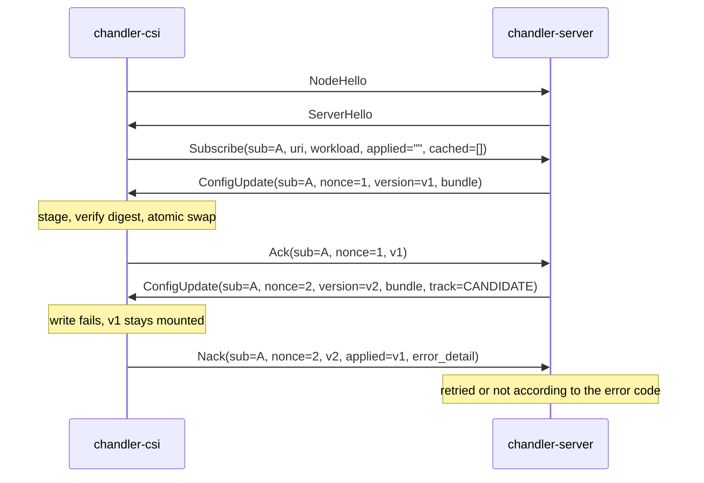
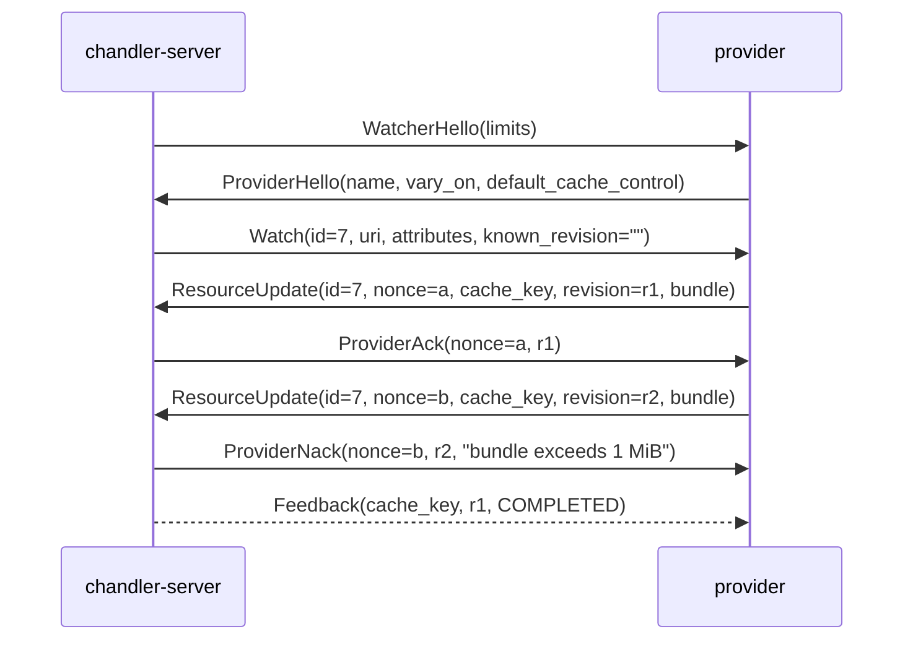
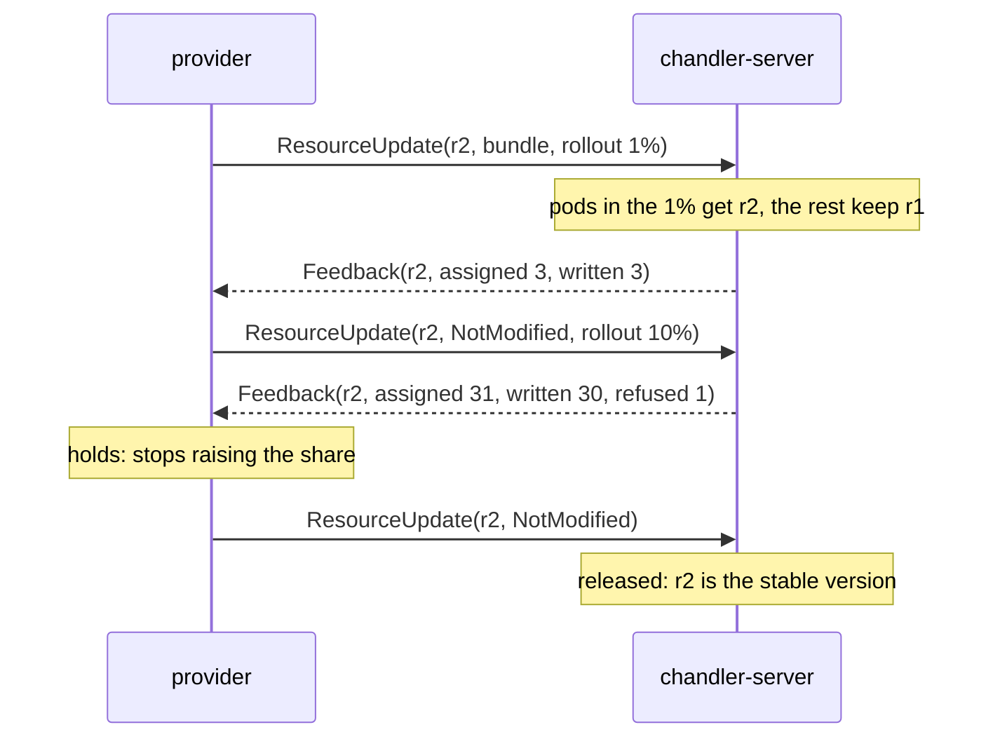

# Chandler: configuration delivery over CSI

Status: draft, 2026-10-12

This document describes the target. What is built so far is listed under
"Implementation status" at the end.

Chandler mounts configuration files into pods through a Kubernetes CSI driver.
A pod names what it wants with URIs (`<provider-name>://...`); the driver
subscribes to a config server, which sources the content from pluggable
providers, caches it, rolls new versions out progressively, and pushes them to
the node. The node replaces the files atomically and keeps the last known good
version whenever anything upstream fails or a new version cannot be written.

The wire contracts are in [`api/chandler/v1`](../api/chandler/v1):
`discovery.proto` (driver ↔ server), `provider.proto` (server ↔ provider),
`peer.proto` (server ↔ server), `common.proto` (shared types). This document explains the design around them.

## 1. Goals and non-goals

Goals

- Config files appear in a pod volume before its containers start, and are
  updated in place without restarting the pod.
- Driver ↔ server protocol with per-update ACK/NACK, in the style of Envoy xDS.
- Providers are plugins behind one bidirectional-streaming gRPC interface.
- Staged rollout: a new version reaches pods gradually, by percentage, rather
  than all at once. The provider owns the ramp and can hold it or take the
  version back.
- Provider failure, server failure and node restarts do not take config away
  from running pods and, where a cache exists, do not block new pods.
- Updates are atomic per volume; the last known good config is always kept.
- An application can optionally report whether it loaded or rejected a
  config, over a plain HTTP API on a Unix socket in the volume. A rejection
  reverts that pod and is reported to the provider, which can hold a rollout.
- Caching is keyed by provider-issued cache keys and is bounded by design.
- Configuration content is opaque to the server and the driver. Neither parses
  or interprets it; a provider is responsible for the validity of what it
  emits.

Non-goals

- Validating configuration. The server and driver check only what they need
  to deliver a bundle safely: its digest, its size and file count, and that
  its paths stay inside the volume. Whether the content is a good config is
  the provider's concern before it emits and the application's after.
- How configuration gets into a provider. Authoring, uploading and
  validating config happen on the provider's side of the `ConfigProvider`
  interface. Chandler defines how config is delivered, not how it is
  published; each provider must offer its users a safe way to do that.
- Large artifacts. A bundle is capped (default 1 MiB, hard cap 3 MiB) and sent
  in one gRPC message; there is no chunking.
- Secrets management. Content can be marked `no_store`, but Chandler is not a
  replacement for a secrets driver.
- Templating or merging config on the node. Providers produce final bytes.
- Telling the application to reload. Apps watch the volume, exactly as they do
  for ConfigMap volumes.

## 2. Architecture



| Component | Runs as | Responsibility |
|---|---|---|
| `chandler-csi` | DaemonSet, CSI node plugin (ephemeral inline volumes) | Mount volumes, hold one stream to the server, atomically write updates, ACK/NACK, node cache |
| `chandler-server` | Deployment, several replicas, cache on `emptyDir` | Authorise subscriptions, coalesce them into provider watches, cache and replicate the cache to peers, decide which version each pod gets (rollouts), push |
| Providers | In-process (built-in) or separate gRPC services | Resolve a URI to a bundle, issue its cache key and revision, push changes |

Each cluster runs its own set of server replicas. A provider may be shared by
several clusters, which is why rollouts belong to the provider (section 8)
and the server keeps no state in the Kubernetes API.

There are three cache tiers, each able to serve when the one above it is gone:
origin → server cache → node cache → the volume itself (which is never emptied).

### Pod API

```yaml
volumes:
  - name: config
    csi:
      driver: csi.chandler.dev        # placeholder domain
      readOnly: true
      volumeAttributes:
        sources: |
          - uri: s3://acme-config/payments/app.yaml
            path: app.yaml
          - uri: s3://acme-config/shared/flags/     # trailing slash: directory bundle
            path: flags
        failurePolicy: UseCached      # or Fail (default)
        medium: Memory                # optional: keep the volume off the node's disk
```

Each source has a `uri`, a `path` and an optional `name` (default: the path).
The `path` is where the source appears in the volume, and sources may not
overlap. For a URI naming one object it is the file itself, so the pod chooses
the file name whatever the object is called at the origin. For a directory URI
(trailing slash) it is the directory the bundle's files are placed in.

The `CSIDriver` object sets `attachRequired: false`,
`volumeLifecycleModes: [Ephemeral]`, `podInfoOnMount: true`, a
`tokenRequests` entry with the server's audience and `requiresRepublish:
true`, so every mount carries the pod's namespace, name, UID, service account
and a pod-bound token, and kubelet renews the token before it expires.

## 3. URIs and cache keys

A subscription names a resource as `<provider-name>://<authority>/<path>?<query>`.
The scheme selects the provider; everything after it is the provider's to
interpret. The server canonicalises the URI before doing anything else:
lowercase scheme, remove dot segments, sort query parameters, drop the
fragment, reject userinfo.

The mapping to HTTP caching is direct:

| HTTP | Chandler |
|---|---|
| Request URL | Canonical URI |
| `Vary` | `ProviderHello.vary_on`: subscriber attributes the content may depend on |
| Cache key | `cache_key` issued by the provider in every `ResourceUpdate` |
| `ETag` | `revision` (provider's opaque validator) |
| `If-None-Match` / 304 | `Watch.known_revision` / `NotModified`; `Subscribe.cached_versions` / `UseCached` |
| `Cache-Control: max-age, stale-if-error, no-store` | `CacheControl` |

Two identifiers are kept apart on purpose. The **revision** is whatever the
provider uses to detect change (an ETag, an object version). The **version** is
`sha256` over the bundle's canonical encoding, computed by the server. Drivers
and rollouts only ever see versions, so a provider re-emitting identical bytes
under a new revision causes no rollout and no churn.

### Why the provider issues the key

Only the provider knows which parts of a URI are significant. `cache_key` is
its normalised identity for the resource, and many URIs may collapse onto one
key. The server stores a small alias `(canonical URI, vary values) → cache_key`
so that it can answer from cache without the provider.

### Preventing cache explosion

The cache is bounded by construction rather than by eviction alone:

1. **Keys come from the provider, never from the client.** Providers must
   reject query parameters they do not understand (`INVALID_ARGUMENT`) instead
   of ignoring them, so decorating a URI cannot mint new aliases or keys.
2. **Vary is declared once and allow-listed.** A provider states `vary_on` in
   its handshake; the server refuses any attribute not on its allow-list of
   low-cardinality attributes (cluster, region, zone, namespace, service
   account). Pod name, UID and IP can never enter a key. `Watch.attributes`
   carries only the declared attributes, so the provider cannot vary on
   anything else even by accident.
3. **Per-pod differences are not cache entries.** Rollout placement is the
   only per-pod decision in the system, and it selects among the few versions
   already held for one key. It never creates a key.
4. **Content is stored once.** Bytes live in a content-addressed store; keys
   point to digests. Ten keys with identical content cost one blob.
5. **Versions per key are capped at three**: stable, candidate, previous.
   Rejected versions are remembered as digests only.
6. **Quotas fail loudly.** Per provider: max keys, max bytes, max keys per
   canonical URI (the variant cap, default 16). Per namespace: max distinct
   URIs. Per bundle: max bytes and files. Exceeding one NACKs the provider or
   fails the subscription with `RESOURCE_EXHAUSTED`. Nothing in use is ever
   evicted to make room.
7. **Eviction is by reference.** A key with live subscriptions is pinned. An
   unreferenced key is kept for a grace period (default 24h, so pods can
   restart through a provider outage) and is then LRU-evictable.
8. **Negative results are cached briefly** (`NOT_FOUND`, `PERMISSION_DENIED`;
   default 30s, bounded count) so a crash-looping pod cannot hammer a provider.

Keys per provider and variants per URI are exported as metrics, with the
quotas as alert thresholds.

## 4. Driver ↔ server protocol

One stream per node carries every subscription on that node. A subscription is
one source of one pod volume: `(subscription_id, uri, workload)`.



Rules

- **Every `Subscribe` gets exactly one initial answer**, a `ConfigUpdate` or a
  `SubscriptionError`. This is what unblocks `NodePublishVolume`. After an
  error the subscription stays open and an update follows when one exists.
- **ACK means written.** The bundle was verified against its digest and
  atomically swapped into the volume; the version is now that subscription's
  last known good. The driver cannot tell a good config from a bad one, so an
  ACK says nothing about the content.
- **NACK means not written**, with the previous version untouched. It reports
  a delivery failure, never an opinion about the content; `error_detail` says
  which (see the table in section 5).
- **Nonces** are unique per stream. The server tracks, per subscription, the
  last sent nonce and version, the last ACKed version and the last NACK. An
  ACK or NACK whose nonce is not the latest sent for that subscription is
  ignored: the server may supersede an unanswered update, and only the newest
  counts.
- **Whether a NACKed version is resent depends on the code.** `DATA_LOSS`
  makes the server resend the full bundle at once. A node-side failure
  (`RESOURCE_EXHAUSTED`, `INTERNAL`) is retried with backoff. A bundle that
  can never be written to that volume (`FAILED_PRECONDITION`,
  `INVALID_ARGUMENT`) is not resent to that subscription.
- **No answer within 60s** and the update is sent again once.
- **Reconnect** is a full resync: the driver resubscribes everything with
  `applied_version` and `cached_versions`. The server answers each with its
  target version, as `UseCached` when the node already has the bytes, so a
  resync moves metadata only. Drivers reconnect with jittered backoff; the
  server sets a max connection age to rebalance streams across replicas.
- **`AppReport` is a separate, optional stage after the ACK.** For volumes
  that opt in, the driver relays the application's own verdict (loaded or
  rejected) on a version it wrote; see "Application acknowledgement" in
  section 5. It needs no answer.
- **Config is never withdrawn from a running pod.** The protocol has no delete
  toward the driver; see deletion handling in section 7.

Unlike xDS, requests are a `oneof` and a response carries a single
subscription's update. Envoy's overloaded `DiscoveryRequest` makes an ACK and a
subscription change look alike, and a NACK there rejects a whole response; here
a failed write for one pod's source must not affect any other pod on the node.

## 5. Node: atomic replacement and last known good

State lives under a hostPath so mounts and cache survive driver restarts:

```
/var/lib/chandler/
  cache/                              node cache, node-wide
    blobs/sha256/<aa>/<digest>        file contents, content-addressed
    manifests/<digest>.json           one bundle: its files and the blob of each
    index.json                        canonical URI → versions held, newest first
  volumes/<volume-id>/                CSI volume ID; kubelet derives it from pod UID and volume name
    meta.json                         sources, applied versions (for resubscribe)
    data/                             bind-mounted read-only into the pod
      ..2026_10_12_07_51_00.123/      generation directory (current)
      ..2026_10_12_07_40_11.987/      generation directory (previous)
      ..data -> ..2026_10_12_07_51_00.123
      app.yaml -> ..data/app.yaml
      flags    -> ..data/flags
      ..chandler.json -> ..data/..chandler.json   only with appAck
      ..chandler.sock                             only with appAck
```

Applying an update, per subscription:

1. **Stage.** Write the bundle into the node cache (or locate it, for
   `UseCached`). Verify the version digest.
2. **Check deliverability.** Paths stay inside the volume, size and file
   count are within limits, and no path collides with the volume's other
   sources. File contents are never opened or parsed. Failure → NACK, nothing
   on disk has changed.
3. **Build a generation.** A new directory holding the *whole volume*: this
   source's new bundle plus the currently applied bundle of every other
   source. Files are copied from the node cache: a hardlink would share its
   mode with every other bundle holding the same bytes, and bundles are
   small.
4. **Swap.** Create a `..data_tmp` symlink to the new generation and
   `rename(2)` it over `..data`. This is the same mechanism as Kubernetes'
   atomic writer for ConfigMap volumes: readers see the old tree or the new
   tree, never a mix, and existing `..data` watchers work unchanged.
5. **ACK**, update `meta.json`, and garbage-collect all but the current and
   previous generation.

The driver NACKs only for these reasons:

| Code | Cause | Server reaction |
|---|---|---|
| `DATA_LOSS` | Digest mismatch, or a `UseCached` version missing from the node cache | Resend the full bundle |
| `RESOURCE_EXHAUSTED` | Node disk or the volume's size limit is full | Retry with backoff |
| `INTERNAL` | I/O error while staging or swapping | Retry with backoff |
| `FAILED_PRECONDITION` | A path collides with another source of the same volume | Do not resend; reported to the provider as refused |
| `INVALID_ARGUMENT` | Unsafe path or bundle over the limits (the server should have refused it) | Do not resend; reported to the provider as refused |

Last known good therefore means the last version successfully written, or,
for a volume with application acknowledgement, the last version the
application reported as loaded. It holds at three levels: a failed update leaves `..data` where
it was; the previous generation stays on disk; and the node cache keeps the
blobs of the current and previous version of every live volume, so a server
rollback is a `UseCached` update and a local swap, with no bytes on the wire.

### Application acknowledgement

An ACK from the driver means "written". An application can optionally add the
stage only it can judge: "loaded" or "rejected". This keeps the core opaque:
the application decides whether a config is good, and the driver and server
only carry its verdict.

A volume opts in with the attribute `appAck: "true"`. The driver then adds two
entries at the volume root:

```
..chandler.json -> ..data/..chandler.json    manifest of the current generation
..chandler.sock                              Unix socket served by the driver
```

**Manifest.** Written into every generation directory, so it is swapped
atomically with the content it describes. A volume can combine sources from
several providers, so the manifest lists each one with its own version. A
source's `name` comes from the volume attributes and defaults to its `path`.

```json
{
  "generation": "g-5d41402abc4b2a76",
  "sources": [
    {"name": "app",   "uri": "s3://acme-config/payments/app.yaml", "path": "app.yaml", "version": "sha256:9f86d0..."},
    {"name": "flags", "uri": "flagstore://payments/eu",            "path": "flags",    "version": "sha256:2c26b4..."}
  ]
}
```

`generation` identifies this exact combination of source versions.

**Socket.** The driver serves plain HTTP/1.1 with JSON bodies on the socket;
there is no gRPC and no client library. Connecting works although the volume
is mounted read-only. Each volume has its own socket, so the driver knows
which pod and volume is speaking without any authentication; any container
that mounts the volume may report, which also lets a sidecar report on behalf
of an application that cannot be changed.

| Request | Purpose |
|---|---|
| `GET /v1/config` | The manifest, plus the state the driver has recorded for each source (`pending`, `loaded`, `rejected`) |
| `POST /v1/reports` | Report the outcome of loading a generation |

A report names the generation the application read and gives a state for all
of it, or for individual sources:

```json
{"generation": "g-5d41402abc4b2a76", "state": "loaded"}
```

```json
{
  "generation": "g-5d41402abc4b2a76",
  "sources": [
    {"name": "app",   "state": "loaded"},
    {"name": "flags", "state": "rejected", "message": "unknown flag 'checkout.v3'"}
  ]
}
```

```
curl --unix-socket /etc/payments/..chandler.sock \
  -d '{"generation":"g-5d41402abc4b2a76","state":"loaded"}' http://chandler/v1/reports
```

- With `sources`, only the listed sources are affected; the others stay
  `pending`. An application whose components load different sources at
  different times sends several reports and they accumulate.
- Without `sources`, the top-level `state` applies to every source.
- The driver resolves the generation to source versions and records each
  verdict against `(source, version)`, so a report stays meaningful for the
  sources that did not change when a newer generation has arrived meanwhile.
- Responses: `204` accepted; `400` malformed; `404` unknown source name;
  `409` when the generation is neither the current nor the previous one, with
  the current manifest in the body so the application can reload and retry.

**What the driver does with a verdict.**

- `loaded`: the version becomes the source's last known good, which now means
  the last version the application accepted rather than the last one written.
- `rejected`: the driver immediately builds a new generation with that source
  back on its last loaded version and swaps it in, without waiting for the
  server. The application may still hold the old config in memory, but if it
  restarted it would otherwise read the rejected files from disk. A rejection
  of the whole generation reverts every source whose version differs from its
  last loaded one. If a source has never had a loaded version (first mount)
  there is nothing to revert to and the files stay.
- Either way the driver forwards an `AppReport` to the server for each source
  affected. The server does not send a rejected version to that subscription
  again, and the provider is told, so that it can hold a rollout (section 8).

**Silence.** A volume can also set `appAckTimeout: 2m`. A version the
application was given and has not reported on within that time is reported
`overdue` to the server, by the driver, once. Nothing is reverted: a pod is
never taken back for being slow to report, and a late report still counts and
replaces the mark. The provider is told how many are overdue and may hold a
rollout on it (`--rollout-max-overdue`, default 5). The clock starts again
after a driver restart.

Verdicts are kept in `meta.json`, and the driver re-creates the sockets when
it restarts. The driver binds through a directory file descriptor, so the
socket's long host path does not hit the 108-byte limit; inside the container
the mount path plus `/..chandler.sock` must fit in it. As with updates, a
`subPath` mount sees neither the manifest nor the socket.

### Mounting

`NodePublishVolume` creates the volume directory, subscribes every source and
waits for all initial answers (deadline 90s, inside kubelet's own timeout)
before mounting, so a container never starts with a partial volume. If the
server is unreachable or answers `UNAVAILABLE`:

- `failurePolicy: Fail` returns an error; kubelet retries and the pod waits in
  `ContainerCreating` with an event explaining why.
- `failurePolicy: UseCached` materialises the newest cached version for each
  source if the node cache has one, mounts, and converges once the server
  returns. With no cached version it fails as above.

On driver restart the mounts are still in place; the driver rebuilds its
subscriptions from the `meta.json` files and resyncs.

**Volumes in memory.** With the attribute `medium: Memory` the whole volume is
a tmpfs: nothing of it is ever on the node's disk. That is the only kind of
volume a `no_store` bundle is written to. On any other it is refused
(`FAILED_PRECONDITION`), and a mount waiting for it fails at once with a
message naming the attribute, so content a provider wants kept off persistent
storage cannot land on disk because a pod forgot to ask. The pod declares it,
rather than the driver deciding when the first bundle arrives, because a
mounted volume cannot be moved if a source turns `no_store` later. `no_store`
bundles never enter the node cache either, so they do not survive a node
reboot without the server. The tmpfs is mounted on the host, so it outlives a
driver restart; its memory is charged to the driver. As with ConfigMaps, `subPath` mounts
do not see updates.

## 6. Server ↔ provider protocol

Each server replica dials each registered provider and holds one stream. Many pod
subscriptions coalesce into one watch per `(canonical URI, projected vary
attributes)`.



- `ProviderAck` means the revision was accepted for delivery and cached. The
  server checks only the envelope: bundle size and file count, path safety,
  and the cache-key and quota rules. It never inspects the content.
  `ProviderNack` means the envelope was refused and the server keeps serving
  its last version.
- **Validity is the provider's job.** Anything a provider emits is written to
  pods as is, so a provider must only emit revisions it knows to be valid.
  The expected way to guarantee that is to validate on upload: the provider
  owns the path by which config enters its store (an upload API, a review
  gate, a signing step) and refuses invalid config there, so that nothing
  invalid is ever stored, let alone emitted. That path is entirely the
  provider's; it is not part of Chandler and does not appear in these
  protocols.
- `Feedback` tells the provider how a revision fares on the pods, which an
  ACK cannot know yet; see section 8.
- On reconnect the server re-watches everything with `known_revision`; the
  provider answers `NotModified` for what has not changed.

### File provider

The file provider serves the files below one directory. It is the smallest
provider there can be, with no credentials and no network origin, which makes
it the plainest example of the protocol and lets the end-to-end suite run
without any external service. It is also useful as it is: the directory can be
a mounted ConfigMap, or a checkout a git-sync sidecar keeps current.

Like the S3 provider it has no upload path of its own and emits whatever is in
the directory; whoever writes there is responsible for its validity.

| Aspect | Behaviour |
|---|---|
| URI | `<name>:///<path>` for one file; `<name>:///<path>/` for a directory tree. An authority or any query parameter is rejected. |
| `cache_key` | The canonical path. |
| `vary_on` | empty |
| `revision` | The content address of the bundle. |
| Change detection | Poll (default 2s). A resource is read twice and emitted only when both reads agree, so a directory being rewritten is not emitted half old and half new. |
| Links | Followed, so a directory maintained by an atomic writer reads as its current content. Entries whose name starts with `..` are that writer's bookkeeping and are never served. |
| Limits | A resource over the server's limits is reported `RESOURCE_EXHAUSTED` without being read into a bundle. |
| Deletion | `Deleted` once a file or directory that was served is gone. |

A change to a mounted ConfigMap reaches the provider's pod only when kubelet
refreshes the mount, about once a minute, so that is the delay to expect with
that origin.

### S3 provider (reference implementation)

The S3 provider is a reference implementation of `ConfigProvider`, not the
intended production provider and not the only one. It exists to show the
protocol end to end with the simplest possible origin, and to be the thing
other providers are modelled on.

It is read-only and has no upload path of its own: it emits whatever is in the
bucket. It therefore relies on whoever writes to the bucket to have validated
the content, which is a weaker guarantee than the contract above asks of a
real provider. A production provider would put its own upload API in front of
its store and validate there.

| Aspect | Behaviour |
|---|---|
| URI | `s3://<bucket>/<key>` for one object; `s3://<bucket>/<prefix>/` for a directory bundle. Any query parameter is rejected. |
| Buckets | An allow-list. Without one the provider serves any bucket its credentials can read, to any pod. |
| `cache_key` | `<bucket>/<key-or-prefix>` |
| `vary_on` | empty |
| `revision` | Object: version id if the bucket is versioned, else ETag. Prefix: hash of the sorted `(key, ETag)` list. |
| Change detection | Jittered poll (default 30s) using `HeadObject` / `ListObjectsV2` and conditional `GetObject`; the content is read only when the revision changed. S3 event notifications are deliberately not used: polling is enough, and the interval is configurable. |
| Consistent prefix read | List, then `GetObject` each key with `If-Match` on the listed ETag; any mismatch or missing key restarts the read, so a bundle is never a mix of two uploads. Zero-byte "folder" keys are skipped. |
| `CacheControl` | `max-age`, `stale-if-error` and `no-store` from a single object's `Cache-Control` header, else provider defaults. A prefix has none of its own. |
| File modes | Not carried: S3 has none, so files get the default `0444`. |
| Deletion | `Deleted` once the object or the whole prefix is gone. |

The provider name is the scheme, so two buckets with different credentials are
simply two registered providers (`s3-prod://`, `s3-shared://`) of the same
implementation.

## 7. Server cache, peer sync and provider failure

Each replica keeps a cache on an `emptyDir`: a content-addressed blob store, a
key index (`cache_key → current version, held versions, revision,
CacheControl, last refresh`) and the alias table. `no_store` bundles are held
in memory only.

A subscriber attribute may enter a resource's identity only if the provider
declared it in `vary_on` and it is one of `cluster`, `namespace` or
`service_account`. A provider that declares anything else is refused at the
handshake.

The default quotas are 10,000 keys and 1 GiB per provider, 16 keys per
canonical URI, and 1,000 distinct URIs per namespace.

There is no persistent volume. A volume per replica is zone-bound, so it would
keep a replica from rescheduling in exactly the failures the cache exists for,
and it would make the config system depend on a storage driver to start. The
cache is small by construction, so replicas keep each other's copies instead.

### Peer sync

Replicas find each other through a headless Service and speak `PeerSync`
([`peer.proto`](../api/chandler/v1/peer.proto)).

- **Warm-up.** A starting replica lists the keys of every ready peer and
  fetches every bundle it lacks before it reports ready (for at most a
  minute). An `emptyDir` survives
  container restarts, so after a crash this is usually a no-op. If no peer is
  ready (first replica, or the whole fleet was lost) it becomes ready at once
  and fills from the providers on demand.
- **Anti-entropy.** Every 30s each replica lists one peer's keys and pulls
  what it lacks. All replicas converge on the union of keys, including keys
  only one replica's drivers subscribe to, so drivers can move to any replica.

Bundles are verified against their version digest on receipt. When entries
differ, a replica with a live provider watch for the key trusts its own
stream; otherwise it adopts the entry most recently confirmed with the
provider. Eviction uses the same grace period everywhere on a merged
last-referenced time, so one replica does not resurrect what another evicted.

A PodDisruptionBudget, zone spreading and the warm-up readiness gate ensure a
rolling restart never proceeds until the new replica holds the cache, even
while a provider is down.

### Provider failure

| Key state | Condition | New subscriptions | Existing subscribers |
|---|---|---|---|
| Live | Provider watch healthy | Served, `stale=false` | Receive pushes |
| Stale | Provider down, within `max_age + stale_if_error` | Served, `stale=true` | Keep applied version |
| Expired | Provider down, past `stale_if_error` | `UNAVAILABLE` | Keep applied version |

`stale_if_error` defaults to unlimited: for configuration, an old version is
almost always better than none. When the provider returns, the server
re-watches with `known_revision` and resumes normal operation. A rollout in
progress stays at its share during the outage.

**What is not covered.** If every replica loses its cache at the same time
while a provider is down, the server has nothing to serve for that provider's
keys. Running pods are unaffected. New pods on nodes without a node cache wait
for the provider; new pods on nodes with one start only if they set
`failurePolicy: UseCached`.

**Deletion at the origin** is treated as dangerous. The key is marked
orphaned and keeps being served from the cache, to running pods and to new
ones.

## 8. Staged rollouts

The purpose of a rollout is that a new version does not reach every pod at the
same moment. A new version is released to a growing share of its subscribers
over time. Because the content is opaque, nothing in Chandler can judge
whether a version is good: the ramp buys time for people and their monitoring
to notice a bad one and stop it before it is everywhere.

**The provider owns the rollout.** It already owns how configuration is
published and validated; how it is released belongs with them. A provider is
often shared by several clusters, and one place then decides how a change
reaches all of them. The server needs no rollout objects, no leader and no
access to the Kubernetes API.

The division of work:

| Provider | Server |
|---|---|
| Decides the share of subscribers that gets a new revision, and when to raise it | Decides which pods are in the share |
| Holds the rollout, or takes the revision back | Keeps the stable version for the rest |
| Decides what to do with the feedback | Reports how the revision fares on its pods |

**Protocol.** A `ResourceUpdate` may carry a `Rollout` with a share in basis
points. The provider raises the share by sending the same revision again, as
`NotModified` so that no bytes travel, and releases the revision by sending it
with no `Rollout`. The stable version is the last one released to everyone;
the server holds it, and replicas copy it from each other.



**Who gets the new version.** A pod receives the candidate when

```
sha256(version | 0x00 | pod UID), first 8 bytes, mod 10000 < basis points
```

and the stable version otherwise. This needs no per-pod state and no
coordination: any replica gives the same answer for the same pod. The set only
grows as the share rises, so a pod never flips back and forth. Salting with
the version means a different set of pods goes first each time. Pods that
start mid-rollout are placed by the same rule. The provider never sees a pod's
identity, and a key never holds more than the stable version, the candidate
and the previous stable version.

**Three rules protect pods from a provider's mistakes and restarts.**

- The share of a candidate never shrinks. A smaller value than one already
  received for the same content is ignored, and replicas exchange the share
  with the cache entry, so a pod keeps its version whichever replica it talks
  to.
- A resource's first version goes to everyone, whatever the share: there is
  nothing else to give the rest.
- A revision whose content equals the stable version is not a rollout.

**Holding and taking back.** To hold a rollout the provider stops raising the
share: pods that have the candidate keep it and no more get it. To take a
version back the provider emits the previous content again, as a new revision.
Its version equals the stable one, so the candidate is dropped and the pods
that had it are sent the stable version again (a `UseCached` update, since
their node still has it). A newer version arriving mid-rollout replaces the
candidate; the stable version stays what everyone had.

**While the provider is away** the rollout stays where it is: the server keeps
the last share it was told. A cluster cannot stop or advance a rollout on its
own.

**Feedback.** The server tells the provider, per revision, how many of its
subscriptions are assigned it, have written it, can never write it
(`FAILED_PRECONDITION` or `INVALID_ARGUMENT` NACKs), are failing to write it
for a reason on the node, and, for pods with application acknowledgement,
loaded or rejected it. The numbers are a snapshot per replica; the provider
adds up its replicas. What it does with them is its own decision. Node
problems such as a full disk are reported apart, because they say nothing
about the version.

**The reference ramp.** `common/provider` gives every provider built on it a
time-based ramp, so the file and S3 providers have rollouts without keeping
any state:

- A ramp is a list of shares and holds, `1%:5m,10%:10m,50%:10m`, after which
  the version goes to everyone. Rules give ramps to resources by a pattern on
  their name; with no matching rule a version goes to every pod at once.
- The ramp is measured from when the revision appeared at the origin: a file's
  modification time, an object's `LastModified`. A restarted provider
  therefore computes the same share, with nothing stored.
- A rollout is held where it is while more subscriptions than
  `--rollout-max-refused` (default 0) refuse or reject the revision, or more
  applications than `--rollout-max-overdue` (default 5) are late to report
  on it. A hold is released only after the reports have been clear for 30
  seconds: they are a snapshot, and a subscription is briefly nowhere while
  its driver reconnects.
- An S3 object can carry its own ramp in its metadata (`chandler-rollout`) and
  be held at a share (`chandler-rollout-hold: "10"`).

The reference ramp has limits a production provider would not: time spent held
still counts toward the ramp, a hold on refusals is forgotten when the
provider restarts until the next feedback arrives, and a file provider serving
a ConfigMap restarts the clock of every key when any key changes, because
kubelet rewrites them all (the share never shrinks, so this only delays).

## 9. Security

- Driver ↔ server, server ↔ provider and server ↔ server use mTLS. Both ends
  present a certificate, and a peer is accepted by the identity in it, a DNS
  name or a SPIFFE ID among its subject alternative names, never by its
  address. Only drivers may subscribe, only servers may watch a provider, and
  `PeerSync` accepts only the server identity. Certificates come from files
  that are re-read when they change, or from a SPIFFE Workload API. The
  health service is on its own port without TLS, because kubelet's probes
  cannot present a certificate.
- The server verifies `Workload.service_account_token` (audience-bound,
  pod-bound) and takes namespace, service account and pod identity from the
  token, not from the driver's claims. Verification is offline, against the
  cluster's public signing keys, which the server fetches and caches: a mount
  does not depend on the API server being reachable, and the server needs no
  permission beyond reading those keys. The price is that a deleted pod's
  token stays valid until it expires.
- kubelet renews the token by publishing the volume again
  (`requiresRepublish`). The driver keeps it in memory only, so after a driver
  restart a subscription is refused `UNAUTHENTICATED` until kubelet supplies
  the token again, a few seconds; pods keep their files meanwhile.
- **Authorisation is needed and not designed yet.** The providers hold the
  origins' credentials, so without a check any pod can mount any URI its
  cluster's providers can read. Where the policy lives is open: see the open
  questions.
- The acknowledgement socket is reachable only from containers that mount the
  volume, and a report can only affect that volume and the counts reported to the provider
  of the configs it holds. Request bodies are size-limited.
- Bundle paths are checked on both server and node; the volume is always
  mounted read-only.

## 10. Failure modes

| Failure | Running pods | New pods |
|---|---|---|
| Provider down | Keep current files | Served from server cache (`stale=true`) until `stale_if_error` |
| Provider emits an oversized bundle or unsafe paths | Unaffected; server NACKs provider | Get the last version |
| Provider emits a bad config | Written to the percentage reached; operator pauses or aborts | Placed by the same hash rule |
| Server down, all replicas | Keep current files | `UseCached`: from node cache if present; `Fail`: wait |
| One replica restarts during provider outage | Keep current files | Unaffected; the replica warms from a peer before it is ready |
| All replicas lose their cache during provider outage | Keep current files | Node has a cache and `UseCached`: start; otherwise wait for the provider |
| Provider lost mid-rollout | Keep current files | Placed by the same rule, at the share last told; the rollout neither advances nor stops |
| Driver restarts | Mounts stay; resync on start | Mount waits for driver, kubelet retries |
| Node reboots | n/a | Node cache persists; behaves as server-down or normal |
| Application rejects a config (volume with `appAck`) | That pod is reverted to its last loaded version at once; the provider is told and may hold the rollout | Placed by the same hash rule |
| Update cannot be written on a node | NACK, previous generation stays; retried per error code | n/a |
| Origin object deleted | Keep current files | `Retain`: cached version; `Block`: `NOT_FOUND` |
| Cache quota reached | Unaffected | New keys refused with `RESOURCE_EXHAUSTED`; existing keys unaffected |

## 11. Observability

Every component pushes metrics over OTLP to an OpenTelemetry collector,
configured by the standard environment variables
(`OTEL_EXPORTER_OTLP_ENDPOINT`, `OTEL_METRIC_EXPORT_INTERVAL`,
`OTEL_RESOURCE_ATTRIBUTES`). With no endpoint set nothing is exported and
nothing is dialled. Each reports as its own `service.name`.

| Component | Metrics (`chandler.` prefix) |
|---|---|
| Server | `server.subscriptions`, `server.watches`, `server.provider.connected`, `server.cache.keys`, `server.cache.bytes`, `server.cache.orphaned_keys`, `server.rollouts`, `server.cache.uri_variants`, and the limits `server.cache.keys.limit`, `server.cache.bytes.limit` and `server.cache.uri_variants.limit`, all per provider; `server.namespace_uris` and its limit; `server.peer.sync_age`; `server.resent`; `server.acks`; `server.nacks` and `server.provider.refused` by code; `server.app_reports` by state; `server.peer.adopted` |
| Driver | `csi.volumes`, `csi.server.connected`, `csi.publish.duration` and `csi.apply.duration` by outcome, `csi.mounts_from_cache`, `csi.app_reports` by state, `csi.cache.uris`, `csi.cache.bytes` |
| Providers | `provider.watches`, `provider.updates` by kind, `provider.failures` by code |

Logs are structured JSON on standard error.

**Events.** The driver records a warning event on the pod when something goes
wrong for its configuration, so that `kubectl describe pod` says what
happened:

| Reason | When |
|---|---|
| `ConfigRefused` | A new version can never be written to the volume, for example `no_store` content on a volume that is not in memory. It is not applied. |
| `ConfigWriteFailed` | A new version could not be written for a reason on the node, such as a full disk. It is retried. |
| `ConfigFromCache` | The volume was mounted from the node's cache because the server could not supply it. |
| `ConfigStale` | The server delivered a version it could not confirm with the provider. |
| `ConfigRejected` | The application rejected a version, with its reason. |
| `ConfigOverdue` | The application has not reported on a version in time. |

Recording is best effort and never blocks the driver; the same event for the
same pod is recorded at most once a minute. It is the driver's only use of
the Kubernetes API and needs one cluster-wide permission, creating events;
`--pod-events=false` gives the driver no API access at all. A failed mount
needs none of this: kubelet records it, with the driver's reason.

Not built: traces.

## 12. Open questions

1. **Health-based holding.** For pods without application acknowledgement, a
   bad config is stopped only by someone holding the ramp at the provider.
   Reporting pod restarts or lost readiness to the provider, which needs no
   change to the application, is not designed.
2. **Total cache loss.** When the server has nothing for a key, it could
   answer "use your newest cached version, marked stale" so that pods on
   nodes with a node cache start regardless of `failurePolicy`. Not adopted
   yet.

3. **Authorisation.** Which namespaces and service accounts may read which
   URIs. The candidates are a policy file on the server, per cluster and
   without CRDs, or passing the verified identity to the provider and letting
   it decide, which keeps one policy for all clusters beside the data. Until
   this is settled, any pod can read any URI.

## 13. Implementation status

What exists today, against the design above.

| Area | Built | Not built yet |
|---|---|---|
| Driver ↔ server protocol | Hello, subscribe, unsubscribe, update, ACK and NACK with the per-code reactions, `UseCached` for any version the node holds, `cached_versions`, full resync on reconnect, `AppReport`, one resend of an update unanswered for 60s, keepalives, a max connection age that makes drivers reconnect and spread over replicas | |
| Node | Multi-source volumes, atomic generations, mount only when every source is written, `meta.json`, resuming volumes after a driver restart, node cache (two versions per URI, verified on read, collected after 24h unused), `UseCached` updates and `cached_versions`, `failurePolicy: UseCached`, volumes in memory (`medium: Memory`) as the only place `no_store` content is written | |
| Server | One watch per resource (canonical URI and `vary_on` attributes) shared by its subscriptions, envelope checks, provider reconnect with `known_revision`. Cache on an `emptyDir`: entries by provider cache key with two versions each, aliases, freshness (`stale`, expiry by `max_age` + `stale_if_error`), the four quotas, negative caching, collection after the grace period, `no_store` kept in memory only | LRU eviction under pressure (unused entries simply go after the grace period), authorisation |
| Rollouts | Provider-owned share in the protocol, placement by the hash rule, the three protective rules, taking back and superseding, feedback (assigned, written, refused, failing, loaded, rejected, overdue), rollout state persisted and copied between replicas. Reference ramp in `common/provider` with rules, hold on refusals, rejections and overdue reports, and S3 metadata overrides | |
| Application acknowledgement | `appAck: "true"`, the manifest in every generation, the HTTP API on the socket (`GET /v1/config`, `POST /v1/reports`, per generation or per source), local revert on rejection, verdicts kept across driver restarts, `AppReport` to the server, a rejected version not sent or written again, `appAckTimeout` and overdue reports | |
| Replicas | `PeerSync`: warm-up from every ready peer before reporting ready, anti-entropy with one peer every 30s, the merge rules (own live watch wins, else the most recently confirmed entry; last-referenced merged by maximum), bytes verified on receipt. Headless Service, PodDisruptionBudget, spread constraints, surge-only rolling update | |
| Providers | File provider; S3 provider (objects and prefixes, bucket allow-list, S3-compatible endpoints) | |
| Security | Mutual TLS on every connection, from certificate files re-read on rotation or from a SPIFFE Workload API; peers authorised by identity per service; a chart-issued private authority by default, whose certificates an upgrade renews before they expire, your own Secrets, or SPIRE. The pod's identity verified offline from its service account token | Authorisation of URIs (open question 3) |
| Observability | Metrics pushed over OTLP from every component, events on pods, structured logs (section 11) | Traces |

The server's cache survives a rollout because each new replica copies it from
the ready ones before it takes traffic. If every replica is lost at once, the
cache is gone and is refilled from the providers; nodes with a node cache
still start pods that set `failurePolicy: UseCached`.
